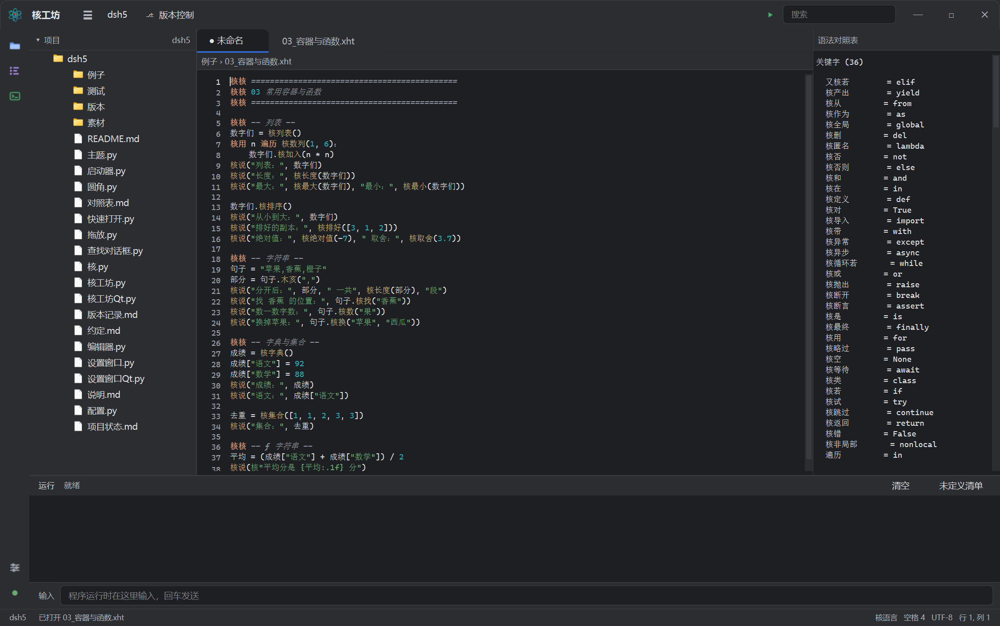
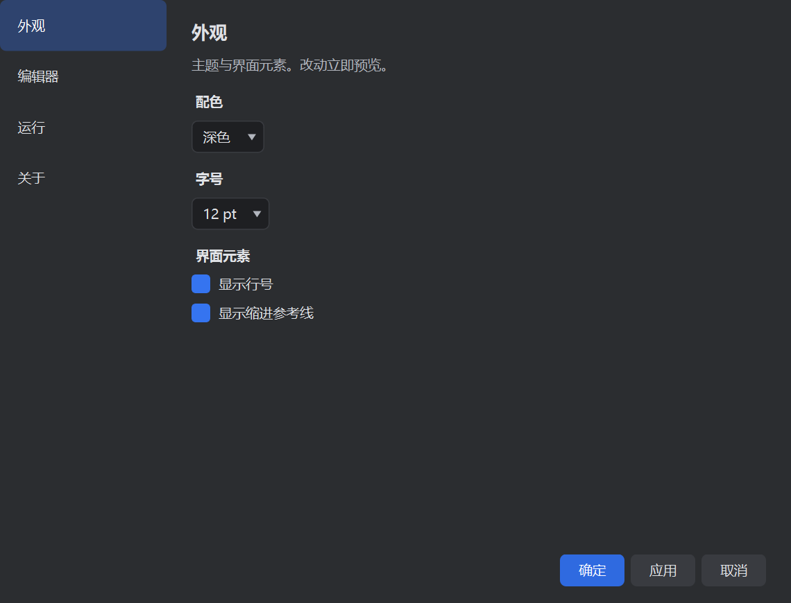

# 核语言（He Language）

一门用中文写程序的语言，语法与 Python 相似。源文件后缀 **`.xht`**。

```python
核说（"你好，世界！"）

核定义 打招呼(名字)：
    核返回 "你好，" + 名字

核用 i 遍历 核数列（1, 4）：
    核说（打招呼（"小明"）, i, "的平方是", i * i）
```

> 本项目不引入任何第三方库：命令行解释器 + PyCharm 风格图形界面，只依赖 Python 标准库。

---

## 特性

**中英文符号视同**
代码区的全角标点自动归一成半角，字符串与注释内容保持原样：

```
核说（"你好，世界！"）      核核 全角括号、逗号都能跑
核说("你好，世界！")       核核 半角写法等价
核说（「引号也认」）         核核 “ ” ‘ ’ 「 」 『 』 都当引号
```

**中英文都认**
`核说` 与 `print`、`核若` 与 `if` 等价，规则表右列的英文（`len`、`sorted`、`end`）同样视为已定义。

**未定义清单：语言可以慢慢长大**
对照表里没有的英文写法，程序照常执行，同时记进 `未定义.txt`：

```
sum	内置函数	2	例子/05_未定义演示.xht:9:19	例子/05_未定义演示.xht:12:5
```

把它补进 `核.py` 的对照表，就变成中文可写了。

**行号不变**
转译只做等长替换，出错时报的行号与 `.xht` 原文一一对应。

---

## 快速开始

### 只想用，不装 Python

从 [Releases](https://github.com/xiaohetaoo/he-language/releases) 下载
`HeLanguage-x.y.z-win64.exe`，双击即可。**它是自带的，目标机器不需要 Python。**

### 想跑源码 / 参与开发

需要 **Python 3.8+**（Windows 上建议勾选 Add Python to PATH）。

| 方式 | 命令 |
| --- | --- |
| 图形界面（Qt 版，主推） | 双击 `核工坊.cmd`，或执行 `核 工坊` |
| 图形界面（旧版，tkinter） | `核 工坊旧`（功能停在 0.0.6，仅作后备） |
| 运行程序 | `核 例子/01_你好.xht` |
| 只查语法 | `核 检查 例子/04_函数.xht` |
| 看转译结果 | `核 转译 例子/03_容器与函数.xht` |
| 交互模式 | `核`（输入 `核退出` 结束） |
| 查看未定义清单 | `核 报告` |

也可以不用 `.cmd`，直接 `python 核.py 例子/01_你好.xht`。

---

## 语法对照表

### 关键字

| 核语言 | Python | 核语言 | Python |
| --- | --- | --- | --- |
| `核若` | `if` | `又核若` | `elif` |
| `核否则` | `else` | `核用 … 遍历 …` | `for … in …` |
| `核循环若` | `while` | `核定义` | `def` |
| `核返回` | `return` | `核删` | `del` |
| `核否` / `核和` / `核或` | `not` / `and` / `or` | `核对` / `核错` | `True` / `False` |

为让第一版能写完整程序，另补了 `核空`(None)、`核断开`(break)、`核跳过`(continue)、`核略过`(pass)、`核是`(is)、`核在`(in)、`核类`(class)、`核试`(try)、`核导入`(import) 等 22 个。

### 内置函数

| 核语言 | Python | 核语言 | Python | 核语言 | Python |
| --- | --- | --- | --- | --- | --- |
| `核说` | `print` | `说核` | `input` | `核整数` | `int` |
| `核实数` | `float` | `核字符` | `str` | `核列表` | `list` |
| `核字典` | `dict` | `核集合` | `set` | `核长度` | `len` |
| `核最小` | `min` | `核最大` | `max` | `核排好` | `sorted` |
| `核绝对值` | `abs` | `核数列` | `range` | `核取舍` | `round` |

### 方法与关键字参数

| 核语言 | Python | 说明 |
| --- | --- | --- |
| `字符串.木亥（…）` | `.split(…)` | 按分隔符切开 |
| `列表.核排序（）` | `.sort()` | 原地排序 |
| `列表.核加入（…）` | `.append(…)` | 追加元素 |
| `字符串.核找（…）` | `.find(…)` | 找不到返回 -1 |
| `字符串.核数（…）` | `.count(…)` | 统计次数 |
| `字符串.核换（…）` | `.replace(…)` | 替换子串 |
| `核说（…, 核尾=""）` | `print(…, end="")` | 不换行 |
| `核说（…, 核隔="-"）` | `print(…, sep="-")` | 自定义分隔符 |

另有 `核去除`(strip)、`核取`(get)、`核上`(upper)、`核连接`(join) 等 20 个补充方法。

### 字符串与注释

| 写法 | 含义 |
| --- | --- |
| `核"总分{总分}，均分{平均:.2f}"` | f 字符串，`{x:.2f}` 等格式原样保留 |
| `核核 这是注释` | 等价 `# 注释`，`#` 也照样能用 |

---

## 图形界面「核工坊」

PyCharm 新 UI 风格，纯 tkinter 实现：圆角按钮与标签页、深浅双主题、语法高亮、缩进参考线、面包屑、项目树、语法对照表、内置运行窗口。



**设置窗口**（`Ctrl+,`）：外观 / 编辑器 / 运行 / 关于 四个分类，主题切换即时预览。



**常用快捷键**

| 快捷键 | 作用 | 快捷键 | 作用 |
| --- | --- | --- | --- |
| `F5` | 运行 | `Ctrl+S` | 保存 |
| `Shift+F5` | 停止 | `Ctrl+N` | 新建 |
| `F9` | 检查语法 | `Ctrl+O` | 打开文件 |
| `Ctrl+F` | 查找替换 | `Ctrl+G` | 转到行 |
| `Ctrl+/` | 注释切换 | `Ctrl+,` | 打开设置 |

**其它**：`.xht` 文件可直接拖进窗口打开，文件夹拖入即切换项目。

---

## 目录结构

```
核.py              内核：转译器 + 命令行 + 交互模式
核工坊.py          图形界面
设置窗口.py        设置弹窗
拖放.py            文件拖入（Windows 原生，仅标准库）
圆角.py            窗口与控件圆角
启动器.py          打包入口，同时充当内置内核
核.cmd / 核工坊.cmd  双击启动器
素材/              图标（PNG 与多尺寸 ICO）
例子/              8 个示例程序（基础→集合→类→异常）
测试/              自测、打包、归档、截图等脚本
版本/              各版本源码快照
说明.md            详细说明书
版本记录.md        版本历史与发布流程
```

---

## 打包成 exe

```
pip install -i https://pypi.tuna.tsinghua.edu.cn/simple pyinstaller
python 测试/打包.py            # 单文件，约 30 MB
python 测试/打包.py --目录      # 文件夹形式，启动更快
```

产物在 `dist/核工坊.exe`。**打包版内置内核**：运行用户程序时调用 exe 自身，目标机器无需安装 Python。

---

## 自测

```
python 测试/跑全部.py      # 全量回归：15 项测试集（推荐，打包前会自动跑）
python 测试/自测.py        # 内核自测
python 测试/自测Qt.py      # Qt 界面功能自测
```

都是标准库 `unittest` 或纯断言，不依赖第三方包。

---

## 版本

每个版本都完整归档在 `版本/` 目录。发布流程见 [版本记录.md](版本记录.md)。

| 版本 | 要点 |
| --- | --- |
| 0.0.6 | **界面迁移到 PySide6（Qt）**：主题集中 QSS、圆角与高 DPI 原生、新增查找替换与跳转行 |
| 0.0.5 | 界面向 PyCharm 新 UI 对齐：自绘顶栏、Darcula 配色、修分栏还原与撕裂 |
| 0.0.4 | 3 个新示例、异常类型中文化、中文模块导入、修字符串内「」被改写 |
| 0.0.3 | 对照表补全 96 项（内置函数 59/67、方法 78/80）、语法高亮不再把变量名断词、覆盖内置给出提示 |
| 0.0.2 | 顶部去掉重复标题栏、配色对比度达标、拖入即时响应、运行输出不再丢、一轮全面审查修复 |
| 0.0.1 | 首个版本：内核、命令行、核工坊界面、拖放、打包 |

### 发布一个版本

```bash
python 测试/归档版本.py          # 归档源码快照到 版本/vX.Y.Z/
python 测试/打包.py              # 出 exe，并自动跑界面自检
python 测试/发布Release.py       # 建 Release 并把 exe 作为附件上传
```

发布脚本需要 Personal Access Token（`Contents: Read and write`），
从环境变量 `GH_TOKEN` 读取。SSH 密钥只能 push 代码，**不能**上传 Release 附件。
上传后会复查页面附件列表，确认 exe 真的在。

若网络屏蔽了 `api.github.com`：脚本会自动改用可用 IP 直连，
大文件走流式分块上传；重试逻辑已内置，不需要额外脚本。

**补发旧版本的 exe**：从 `版本/vX.Y.Z/` 里打包，别用当前代码（版本号会不对）：

```bash
cd 版本/v0.0.1
python -m PyInstaller --onefile --windowed --name 核工坊 \
  --icon 素材/核图标.ico \
  --add-data "素材;素材" --add-data "例子;例子" \
  --add-data "核.py;." --add-data "核工坊.py;." --add-data "设置窗口.py;." \
  --add-data "拖放.py;." --add-data "圆角.py;." \
  --hidden-import 拖放 --hidden-import 圆角 --hidden-import 设置窗口 \
  启动器.py
```

附件名要用 ASCII（如 `HeLanguage-0.0.1-win64.exe`）：
GitHub 会把中文文件名解析成空，最终存成 `default.exe`。

下载页：<https://github.com/xiaohetaoo/he-language/releases>


---

## 已知限制

- 转译器是逐字符扫描，不做完整语法树分析
- 未定义清单只识别英文写法；中文里没定义的新词按普通变量名处理
- 界面无断点调试、代码补全、工程级重构
- tkinter 的原生菜单条无法与窗口标题栏合并，故菜单收在 `≡` 汉堡按钮里

---

## 许可

本项目采用 **MIT 许可证**，详见 [LICENSE](LICENSE)。

你可以自由使用、修改、分发，包括用于商业项目，只需保留版权声明。
